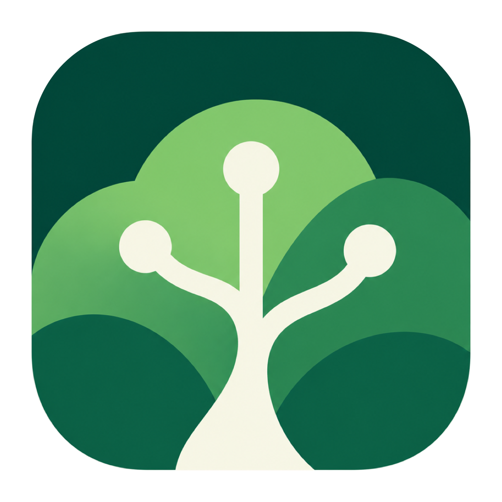
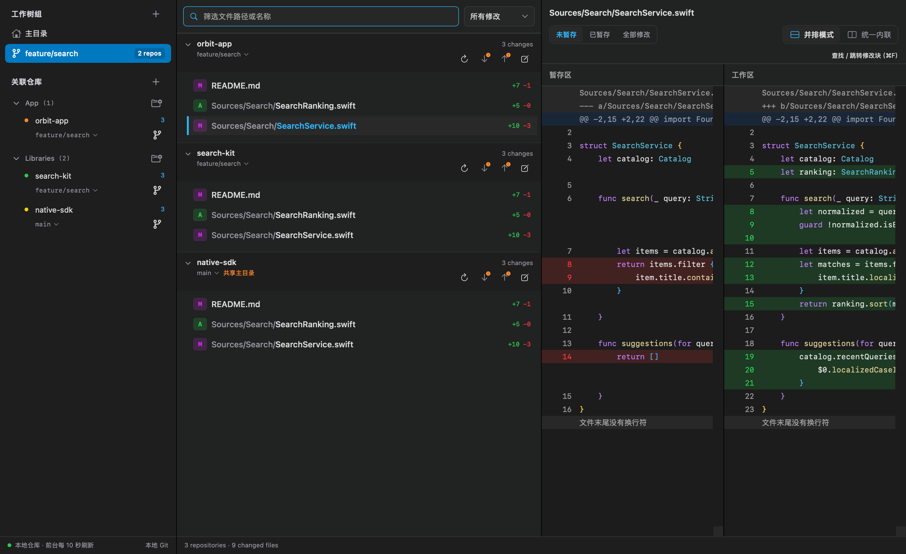

<p align="center">
  
</p>

# Grove

**See the whole change across repositories. Browse a set of worktrees together.**

Grove is a native macOS Git client for projects that span multiple repositories. Bring their uncommitted changes and local commit history into one window, then choose a **worktree group** to review the checkouts associated with the same task.

[简体中文](README.zh-CN.md) · [Getting started](#getting-started) · [Documentation](#documentation)



## One project, multiple repositories

An app, a shared library, and a native SDK may live in separate Git repositories while shipping as one product. Grove brings them into one **project**, with changes grouped by repository so you can see where work is happening and inspect each file's diff.

Use **repository groups** to organize the sidebar—for example, App and Libraries. Filter down to a single repository, or browse local commits from all repositories in a combined timeline.

## Worktree groups follow your task

A **worktree group** remembers which checkout to browse for each repository. Grove discovers existing Git worktrees in the repositories you add and automatically groups extra worktrees with matching branch names. Repositories without a matching worktree use their primary checkout; you can choose a different checkout for any repository and save that choice for the group.

For example, a `feature/search` group could bring together:

| Repository | Checkout shown in the group | Selection |
| --- | --- | --- |
| App | `feature/search` worktree | Matched by branch name |
| Shared library | `feature/search` worktree | Matched by branch name |
| Native SDK | Primary checkout | No matching worktree |

Select the group once to browse that set of changes. Return to **Primary Checkout** to view every repository's primary checkout, even when those checkouts have different branch names.

Selecting a worktree group changes what Grove displays. It does not run `git switch` across your repositories. Switching a checkout's branch is a separate, explicit action.

## Review and act

- **Read changes closely.** Side-by-side and unified diffs, syntax highlighting, search, and a large file preview. Preview image changes, SVG, Android VectorDrawable, and rendered Markdown.
- **Follow local history.** A commit graph per repository, file-level commit diffs, and a combined timeline across repositories.
- **Prepare commits with your Agent.** Use an installed Codex, Claude Code, or OMP with your chosen commit Skill. Review and edit a plan split by whole files, inspect the exact diffs, then confirm local commits. Existing hooks and signing remain in effect.
- **Perform deliberate Git operations.** Switch to an existing local branch, discard selected unstaged changes, or explicitly Fetch, Pull, and Push for one repository. Pull is fast-forward only; Push never force-pushes.

Browsing and automatic refresh use local Git data. Remote Git operations run only when you initiate them. Agent-assisted commit preparation uses your Agent's configured model service, which may process the analyzed content.

## Getting started

Grove runs on **macOS 14 or later** and supports English and Simplified Chinese.

### Build from source

The current packaging script requires **full Xcode with Icon Composer's `ictool`**, plus a valid code-signing identity in your login keychain. Command Line Tools alone are insufficient. It builds for your Mac's architecture.

From the repository root, with those prerequisites configured:

```sh
zsh scripts/build-app.sh
open dist/Grove.app
```

The default signing identity is `MyGit Local Code Signing`, retained for compatibility. To use another installed identity, set `GROVE_SIGNING_IDENTITY="Certificate Name"` when running the build script. See the [build guide (中文)](docs/development.md) for setup, verification, and tests. The default self-signed setup is intended for local development.

### Add your repositories

1. Create a project, then a repository group such as App or Libraries.
2. Add your existing local Git repository directories; you can select several at once. Grove discovers worktrees only from repositories you explicitly add.
3. Select a worktree group in the sidebar to browse its changes.
4. Click a repository name to filter the view. Use its worktree menu to override the checkout for the current group; **Restore Automatic Match** clears the override.

Use **⌘K** for quick switching, **⌘R** to refresh, and **Space** to open a selected file's large diff preview. Agent setup is optional for browsing and remote operations.

## Documentation

The detailed guides are currently in Chinese.

| Guide | Contents |
| --- | --- |
| [User guide](docs/user-guide.md) | Projects, worktree selection, diffs, history, settings, discard, and remote operations |
| [Agent-assisted commits](docs/agent-commits.md) | Agent and Skill setup, plan review, execution, and data access |
| [Development and builds](docs/development.md) | Xcode, signing, tests, benchmarks, icons, and compatibility identifiers |
| [App updates](docs/updating.md) | Configuring an update source and installing updates |
| [Release procedure](docs/releasing.md) | Versioning, packaging, signing continuity, and release verification |

Product behavior is recorded in [DESIGN.md](DESIGN.md), terminology in [CONTEXT.md](CONTEXT.md), and the repository-discovery boundary in [ADR 0001](docs/adr/0001-discover-worktrees-from-registered-repositories.md).

[Homepage source and GitHub Pages setup](docs/github-pages.md)
