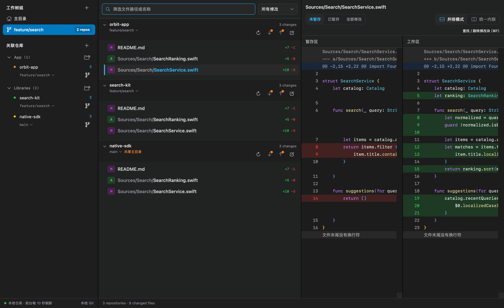

<p align="center">
  
</p>

# Grove

**看清多个仓库的改动，一起浏览同一项工作的 worktree。**

Grove 是面向多仓库工程的原生 macOS Git 客户端。在一个窗口中查看各仓库的未提交修改与本地提交记录，再通过**工作树组**，一次选择与当前任务相关的一整套 checkout。

[English](README.md) · [产品主页](https://etet2007.github.io/Grove/) · [开始使用](#开始使用) · [详细文档](#详细文档)



## 一个工程，多个仓库

应用、共享库和原生 SDK 可以分别存放在独立的 Git 仓库里，却共同组成一个产品。Grove 将它们放进同一个**工程**，按仓库汇总修改，让你看清改动分布，并逐个文件核对 diff。

用**仓库组**整理侧边栏，例如 App 和 Libraries。你可以聚焦单个仓库，也可以在合并时间线中浏览所有仓库的本地提交。

## 用工作树组组织同一项工作

**工作树组**记录每个仓库应该浏览哪个 checkout。Grove 从你添加的仓库中发现已有 Git worktree，将同名分支的额外 worktree 自动归组。没有对应 worktree 的仓库沿用主检出目录；你也可以为任意仓库手动选择其他 checkout，并保存为当前组的例外。

例如，一个 `feature/search` 工作树组可以包含：

| 仓库 | 组内浏览的 checkout | 选择方式 |
| --- | --- | --- |
| App | `feature/search` worktree | 按同名分支匹配 |
| 共享库 | `feature/search` worktree | 按同名分支匹配 |
| 原生 SDK | 主检出目录 | 没有对应 worktree，沿用主目录 |

选中这个组，就能浏览整套修改。切回「主目录」，则查看所有仓库的主检出目录，即使它们当前的分支名各不相同。

选择工作树组只改变 Grove 浏览的目录，不会对多个仓库批量执行 `git switch`。切换某个 checkout 的分支是单独、明确的操作。

## 从审阅到操作

- **核对文件改动。** 并排与统一 diff、语法高亮、查找和放大预览；支持图片前后对比、SVG、Android VectorDrawable 和 Markdown 阅读预览。
- **追踪本地历史。** 按仓库显示提交历史图，查看提交内的文件 diff，也可跨仓库浏览合并时间线。
- **让 Agent 准备提交方案。** 使用本机 Codex、Claude Code 或 OMP，以及你选择的提交 Skill。审阅按完整文件拆分的方案，编辑说明、核对准确 diff，确认后创建本地提交，保留已有 hook 和签名。
- **主动执行 Git 操作。** 切换已有本地分支、丢弃选中的未暂存修改，或对单个仓库执行 Fetch、Pull、Push。Pull 仅 fast-forward，Push 不强推。

浏览和自动刷新只读取本地 Git 数据；Git 远端操作由你主动发起。Agent 辅助提交会使用 Agent 已配置的模型服务，分析内容可能由该服务处理。

## 开始使用

Grove 支持 **macOS 14 或更新版本**，提供简体中文和 English 界面。

### 下载应用

[下载 Grove 0.1.2 Preview（Apple Silicon）](https://github.com/etet2007/Grove/releases/download/v0.1.2/Grove-0.1.2-arm64.zip) · [发布说明与校验值](https://github.com/etet2007/Grove/releases/tag/v0.1.2)

解压后将 `Grove.app` 拖到「应用程序」。本包适用于 **Apple Silicon（M 系列芯片）Mac** 和 macOS 14+，不适用于 Intel Mac。使用预编译包无需安装 Xcode 或配置签名证书。

**此 Preview 使用自签名证书，未经 Apple 公证。** 首次打开可能被系统阻止；如决定信任本发布，尝试打开后，可在「系统设置 → 隐私与安全性 → 仍要打开」中允许。详细步骤与校验方法见[安装指南](docs/install.md)。

### 从源码构建

当前打包脚本需要**包含 Icon Composer `ictool` 的完整 Xcode**，以及登录钥匙串中可用的代码签名身份。仅安装 Command Line Tools 不足以打包。脚本生成适用于本机架构的应用。

配置好前提后，在仓库根目录执行：

```sh
zsh scripts/build-app.sh
open dist/Grove.app
```

默认签名身份为兼容保留的 `MyGit Local Code Signing`。使用其他已安装身份时，在构建命令前设置 `GROVE_SIGNING_IDENTITY="证书名称"`。证书配置、验证与测试见[开发与构建](docs/development.md)；默认自签名方案用于本机开发。

### 添加你的仓库

1. 新建工程，再建立 App、Libraries 等仓库组。
2. 添加已有的本地 Git 仓库目录，可以一次选择多个。Grove 只从你明确添加的仓库中发现 worktree。
3. 在侧边栏选择工作树组，浏览这套 checkout 的修改。
4. 点击仓库名筛选视图；通过仓库的工作树菜单单独指定当前组使用的 checkout，「恢复自动匹配」可清除手动选择。

使用 **⌘K** 快速切换，**⌘R** 刷新，**空格**打开放大 diff 预览。浏览和远端操作无需配置 Agent。

## 详细文档

| 文档 | 内容 |
| --- | --- |
| [使用指南](docs/user-guide.md) | 工程与工作树选择、diff、提交记录、设置、丢弃修改和远端操作 |
| [Agent 辅助提交](docs/agent-commits.md) | Agent 与 Skill 配置、方案审阅、执行及数据读取范围 |
| [开发与构建](docs/development.md) | Xcode、签名、测试、性能验证、图标和兼容标识 |
| [应用更新](docs/updating.md) | 配置更新源与安装更新 |
| [更新发布流程](docs/releasing.md) | 版本管理、打包、签名连续性与发布验证 |

产品行为见 [DESIGN.md](DESIGN.md)，领域词汇见 [CONTEXT.md](CONTEXT.md)，仓库发现边界的原因见 [ADR 0001](docs/adr/0001-discover-worktrees-from-registered-repositories.md)。

[主页源码与 GitHub Pages 发布说明](docs/github-pages.md)
